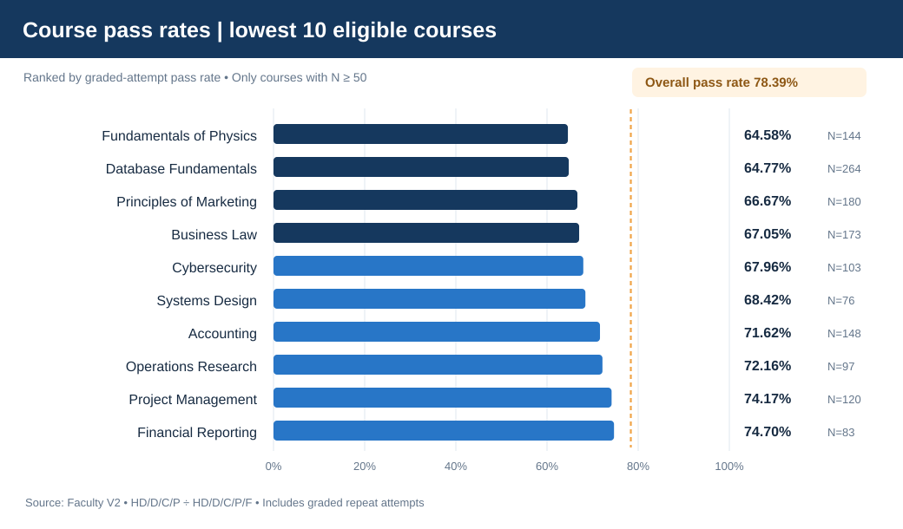

# Aurora University | Power BI for Business Decisions

**Three decision audiences. One fictional university. Evidence before recommendations.**

This portfolio explores how a university could use business intelligence to recognise academic, operational and student-service issues early enough for a structured management review. Aurora University is **fictional**; the featured Faculty V2 data are entirely **synthetic**, and no dashboards were deployed to a real organisation.

## Featured case study — Faculty Analytics

[**Explore the Faculty Academic Performance & Student Support case study →**](faculty/README.md)

The Faculty workstream is a rebuilt, reproducible simulation for **500 students, 44 courses and six teaching terms**. It examines **course pass rates, grade distributions, academic trends and attendance patterns** to answer a practical question: *which courses need further academic review, and what would an evidence-based follow-up look like?*

**Verified V2 snapshot:** 5,742 graded attempts; **78.39%** passed (HD/D/C/P). These results are specific to V2 and are **not** improvements or declines relative to earlier coursework data.

## Other workstreams

| Area | Audience | Status |
|---|---|---|
| **Faculty** | Academic leaders | **V2 case study ready**; Power BI page is being refined |
| **Facilities** | Department / operations leads | Original coursework and earlier demonstration retained; **not yet migrated to V2** |
| **Admissions** | Student administration | Original coursework and earlier demonstration retained; **not yet migrated to V2** |

Legacy project materials under `docs/`, `site/`, `data/`, `sql/`, `test/` and the original numbered Markdown pages are historical material, not the source for Faculty V2 metrics. No new Facilities or Admissions outcomes are claimed here.

**Skills evidenced:** stakeholder question framing, synthetic data modelling, validation, DAX specification, course-level descriptive analysis, visual communication and decision-support design. **Scope note:** data checks are reproducible, but final Power BI interaction/UAT verification and any real-world impact assessment remain outstanding.
