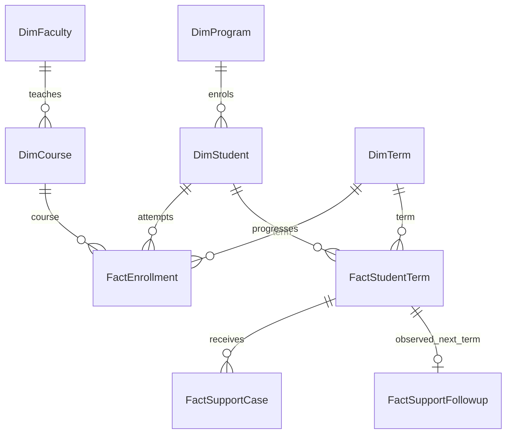

# Data model — what one row means

**Synthetic Faculty V2 | Power BI implementation reference.** Model configuration is specified and validated against CSV keys; it has not been live-tested in the uploaded Power BI Service report.

| One-side key | Many-side key |
|---|---|
| `DimFaculty[Faculty_ID]` | `DimCourse[Faculty_ID]` |
| `DimProgram[Program_ID]` | `DimStudent[Program_ID]` |
| `DimStudent[Student_ID]` | `FactEnrollment[Student_ID]` |
| `DimCourse[Course_ID]` | `FactEnrollment[Course_ID]` |
| `DimTerm[Term_ID]` | `FactEnrollment[Term_ID]` |
| `DimStudent[Student_ID]` | `FactStudentTerm[Student_ID]` |
| `DimTerm[Term_ID]` | `FactStudentTerm[Term_ID]` |
| `FactStudentTerm[StudentTermKey]` | `FactSupportCase[StudentTermKey]` |
| `FactStudentTerm[StudentTermKey]` | `FactSupportFollowup[StudentTermKey]` |

Configure each relationship **one-to-many, single direction**. The student-term table must have a unique `StudentTermKey`; student and course IDs are dimension keys. Set `DimTerm[Term_ID]` to **Sort by column → `Term_Order`** to avoid a reversed chronological trend.

**Grain**: `FactEnrollment` = one student × course × term attempt (6,061 rows, no duplicated triples); `FactStudentTerm` = student × term (1,955 rows); support = offered cases at student-term grain. Do not connect course directly to support, nor let a *teaching faculty* filter change student-support figures without an explicitly agreed population rule.

**Rates**: Pass = HD/D/C/P and valid denominator = HD/D/C/P/F for completed attempts. W and I are **excluded**. Retakes are separate attempts. Average course mark uses `Final_Mark` over completed attempts; `Cumulative_GPA_End` belongs to `FactStudentTerm`, not to a course outcome. Average attendance includes incomplete/withdrawn attempts by V2 design; label this clearly.

**Dashboard fields**: lowest courses → `DimCourse[Course_Name]`, `[Pass Rate]`, `[Graded Results]`; grade mix → `DimCourse[Course_Name]`, `FactEnrollment[Final_Grade]`, `[Grade Count]`; trend → `DimTerm[Term_ID]`, `[Pass Rate]`; scatter → `[Average Attendance]` versus `[Average Course Mark]`, details `DimCourse[Course_Name]`.

[Back to case study](../README.md) · [DAX](faculty-measures.dax) · [Validation](validation.md)
